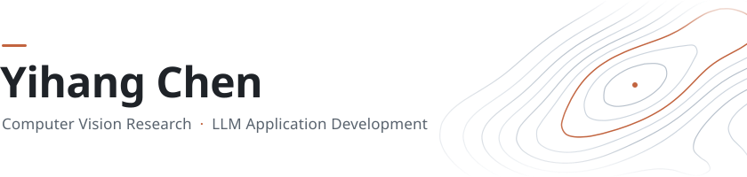

<picture>
  <source media="(prefers-color-scheme: dark)" srcset="assets/header-dark.svg">
  
</picture>

立命館大学大学院 情報理工学研究科の修士課程で、コンピュータビジョンを研究しています。 
研究のかたわら、LLM を組み込んだアプリや、生成 AI を使う制作ツールを個人開発で作っています。 
2028 年入社の新卒採用で、AI エージェント・LLM アプリケーション開発の仕事を志望しています。

## スキル・使用技術

- **開発で使っている技術**　TypeScript / React / Electron / three.js / LangGraph / Ollama
- **研究で使っている技術**　Python / PyTorch
- **開発ツール**　Claude Code / Codex / GitHub
- **語学**　中国語（母語）/ 日本語

## 主な開発経験

### LLM アプリケーションの開発

一文を書くと、遊べる 3D ステージができるブラウザーゲームを作りました。ローカルの LLM は、必要なら登場人物の名簿をツールで調べて、一文をステージの仕様書（構造化出力）に直します。配置を作って検査するのはプログラムです。ルールに合わなければ理由をつけてモデルに差し戻し、プレビューで確定したものだけを保存します。この流れを LangGraph で組んでいます。

[mw-playground](https://github.com/chenyihang98-pixel/mw-playground) · [デモ動画](https://youtu.be/4zSBDaET-JA)

### 生成 AI を使った制作ツールの開発

AI で生成した 3D モデルは、そのままではなかなか使えません。そこで、生成からポリゴン削減、リギング、モーション付け、Unity への送信までを 1 つにまとめた Windows アプリを作り、無料で公開しています。Tripo・Meshy・Tencent Hunyuan の生成サービスにつなぎ、送信前に費用の目安を出す、失敗したタスクを二重課金なしでやり直す、といった実際に使うと困るところを作り込んでいます。

[Modelwright の紹介](https://github.com/chenyihang98-pixel/Modelwright/blob/main/README.ja.md) · [デモ動画](https://youtu.be/fLYk25TaxHo)

**作り方について**　どちらも、コードは主に Claude Code が書き、Codex がレビューする流れで作っています。自分がやっているのは、何を作るかと仕様の判断、使ってみて見つけた問題のフィードバック、公開前の確認です。

## 研究経験・論文

文化財の浮き彫り（レリーフ）の写真から、人物の領域を切り出す研究をしています。浮き彫りは人物と背景の境界が見分けにくいので、画像から得た深度と輪郭の情報を、アダプタを通して SAM に入れる方法を扱いました。筆頭著者の論文が ECCV 2026 の論文集に載っています。

> **ReliefSAM: A Geometry-Augmented Multi-prior Adapter for Bas-Relief Segmentation** 
> **Yihang Chen**, Xiang Lyu, Rui Xu, Jiao Pan, Fadjar Ibnu Thufail, Brahmantara, Jiaqing Liu, Satoshi Tanaka, Liang Li 
> *Computer Vision – ECCV 2026*（LNCS 17063）pp. 429–444 · [論文ページ（Springer）](https://doi.org/10.1007/978-3-032-37211-6_24)

## 最近関心のある分野

LLM やエージェントを、実際に使えるアプリに組み込むところに関心があります。モデルの出力をそのまま信じるのではなく、プログラムで検査して、直させるか、人に確認してもらう。mw-playground で試したこの形を、状態管理や評価のしかたも含めて、もう少し掘り下げたいと思っています。

 

<picture>
  <source media="(prefers-color-scheme: dark)" srcset="assets/footer-dark.svg">
  
</picture>
